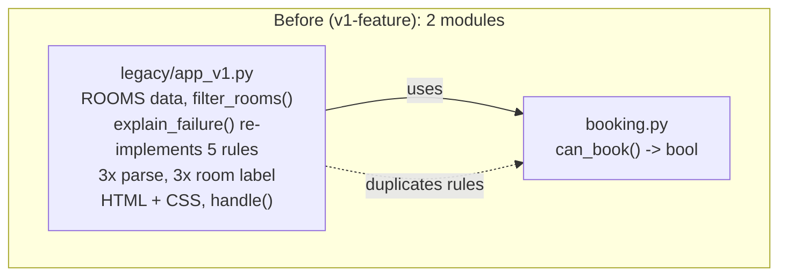
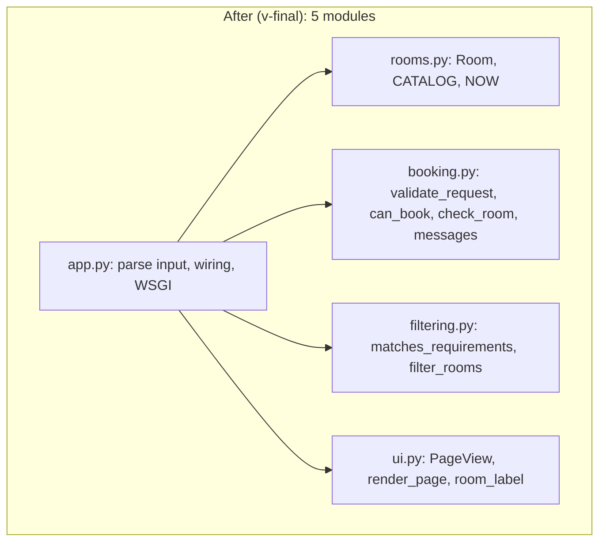

# Software Engineering, Assignment #04
AI-assisted software evolution, refactoring and quality improvement: Smart Campus Room Availability Checker

Name: Zinatov Ruslan
Student ID: 24B031807
AI tool: Claude (Anthropic). Model: configured as `claude-sonnet-5-5` (the serving model may differ; see AI appendix)
Date: [[PASTE: submission date]]
Git: [[LINK: repository URL]], tags `v0-initial`, `v1-feature`, `v-final`

All data is fictional. AI assistance was used for analysis, planning, code, tests and drafts; every command result below comes from a run, and all AI output is recorded in `ai_appendix.md`.

## 1. Scope and preserved rules
Extended the Assignment #03 can_book rules from one room to a catalog of 5 fictional rooms with capacity and equipment filtering. Excluded: login, payments, live APIs, database.

Preserved AC1-AC6 (Assignment #03 report, section 1): AC1 integer minutes, 0 <= start < end <= 1440, start strictly after now; AC2 maximum 120 minutes; AC3 blocked room rejects every request; AC4 overlap rejected, touching allowed; AC5 clear Available / Unavailable result, existing bookings not mutated; AC6 understandable validation feedback and a usable narrow layout.

New rules F1-F5 (assignment slides "New feature: filtering rules"): F1 capacity >= attendees; F2 ALL selected equipment items; F3 blocked room never reported as available; F4 clear empty state; F5 changing the selected room refreshes the result.

Initial version: `booking.py` at tag `v0-initial` (function `can_book`, no interface). The interface is new in v1 (a Python-served HTML page; the Bolt.new page from Assignment #03 is not part of this repository and was not modified).

## 2. Task 01: Codebase analysis
Context given to the AI: repository map (booking.py, test_booking.py, fuzz_check.py, empty booking_v1.py), AC1-AC6, F1-F5, constraints (no login, payments, live APIs or database), the Python 3.12 environment.

Maintainability risks (each reproduced by reading or running the code):

| # | Risk | Reference | Evidence |
|---|---|---|---|
| 1 | `can_book` returns only a bool; any interface that must show a reason has to re-implement the rules | `booking.py:can_book` | v1 needed `explain_failure` in `legacy/app_v1.py` repeating 5 rules |
| 2 | No room concept: `blocked` and `existing` are loose arguments, the caller assembles per-room data | `booking.py:can_book` signature | a catalog has no home; F5 depends on the caller passing the right room's bookings |
| 3 | `existing` entries are not validated: an inverted pair is accepted, a malformed tuple raises | `booking.py:can_book`, loop `for s, e in existing` | run: `can_book(610, 650, 540, False, [(700, 600)])` returned True; `[(700,)]` raised ValueError (Assignment #03 assumption 2 documents this) |
| 4 | The 42 original cases run inside one unittest test, so `Ran N tests` reports 4 | `test_booking.py:AcceptanceTests.test_cases` | baseline output `Ran 4 tests` |
| 5 | Rule constants repeated as literals in the oracle and (in v1) in the UI code | `fuzz_check.py:oracle`, `legacy/app_v1.py:explain_failure` | grep for `1440`, `120` |
| 6 | Empty file left in the repository | `booking_v1.py` (0 bytes) | `git show --stat v0-initial` |

Prioritized plan (written before editing code):
1. Add the feature as is and freeze it as v1 (behavior reference).
2. Introduce one reason-returning validation function; make `can_book` a thin wrapper (risks 1, 5).
3. Introduce a `Room` data type with immutable bookings (risk 2).
4. Extract filtering, then presentation, one change at a time, rerunning the tests after each (workflow steps 4-5).
5. Turn each original case into its own test; add integration and equivalence tests (risk 4).
6. Record risks 3 and 6 as known limitations; do not widen scope.

Rejected or modified AI suggestion: the AI's first plan assumed an HTML and JavaScript stack with `node --test` and jsdom. Modified to a Python standard-library WSGI application with `unittest`, because the repository (`git show --stat v0-initial`) is Python-only and Task #04 needs only one integration or UI behavior check.

## 3. Task 02: Feature extension
Catalog (`rooms.py`): R101 Alpha Lab (30, computers/projector/whiteboard, bookings 600-660 and 780-840); R102 Beta Studio (12, video-conference/whiteboard, 570-630 and 900-960); R103 Gamma Hall (80, projector/video-conference, blocked); R104 Delta Seminar (20, projector/whiteboard, 660-720); R105 Epsilon Pod (6, video-conference, none). Current time fixed at 540.

Run: `python app.py`, open http://127.0.0.1:8000/. Demonstrations (screenshots in `screenshots/`, taken from the running application):

| Demonstration | Query | Result shown | Screenshot |
|---|---|---|---|
| Default page | (none) | all 5 rooms listed | `01_desktop_default.png` |
| Successful filter + available | attendees=10, projector, R101, 700-760 | Alpha Lab (R101): Available for 700-760; Beta and others without projector hidden | `02_filter_success_available.png` |
| Unsuccessful filter | attendees=500 | "No rooms match these requirements." | `03_filter_empty_state.png` |
| Room switching, before | R101, 620-650 | Unavailable - Overlaps an existing booking | `04_switch_room_alpha_unavailable.png` |
| Room switching, after | R104, 620-650 | Available for 620-650 | `05_switch_room_delta_available.png` |
| Blocked room | R103, 700-760 | Unavailable - Room is blocked | `06_blocked_room.png` |
| Narrow layout, validation | 375 px, 720-660 | "End must be after start" | `07_mobile_375_validation.png` |
| Narrow layout, available | 375 px, R104, 720-780 | Available for 720-780 | `08_mobile_375_filtered_available.png` |

Measured with Playwright (Chromium) on all 8 pages: `document.documentElement.scrollWidth == clientWidth` (375 = 375 at the narrow width, 1100 = 1100 at desktop), so there is no horizontal scrolling. A scripted change of the room control from R101 to R104 changed the result from "Alpha Lab (R101): Unavailable - Overlaps an existing booking" to "Delta Seminar (R104): Available for 620-650".

## 4. Task 03: Refactoring
Before (`v1-feature`) and after (`v-final`) diagrams: `diagrams/before.png`, `diagrams/after.png` (sources `before.mmd`, `after.mmd`).

Design decisions:
1. One validation function returning the reason (`booking.py:validate_request`); `can_book` is `validate_request(...) is None`. Reason: the interface needs the message, and two implementations of five rules can drift apart. The `can_book` signature is unchanged, so the original tests and the fuzz check run untouched.
2. Immutable `Room` (frozen dataclass, bookings as tuple of tuples) in `rooms.py`, and `check_room(room, ...)` taking the room object. Reason: AC5 (no mutation) is enforced by the type, and F5 (availability uses the chosen room's bookings) cannot be violated by passing another room's list.
3. Presentation as pure functions of a `PageView` (`ui.py`) and request parsing kept in `app.py`. Reason: the rules and filters can be tested without HTML, and the HTML can be tested without the rules; one parser and one `room_label` replace three copies each.
4. Behavior preserved by evidence, not by inspection: `test_equivalence.py` compares the full HTML of v1 and final.

Order of work: one module at a time, tests rerun after each step.

## 5. Task 04: Automated testing
Commands and results (run in this workspace, Python 3.13.18; full output in `test_results.txt`; replace with your own run on Python 3.12.2 if you rerun):

| Command | Result |
|---|---|
| `python -m unittest -v test_booking` (v0, before changes) | Ran 4 tests, OK |
| `python -m unittest discover -v` (final) | Ran 79 tests, OK |
| `python fuzz_check.py` (v0 and final) | compared 200000 random cases, mismatches: 0 |
| `python mutation_check.py` | mutants: 11, survived: 0 |

Suites (counts from `python -m unittest <module>`): `test_booking` 4, `test_ac_regression` 47, `test_filters` 14, `test_app_integration` 12, `test_equivalence` 2; total 79.

Required coverage:
- AC1-AC5 regression: all 42 original cases as separate tests (`test_ac_regression.py`), plus AC5 immutability tests; AC6 feedback messages and responsive markup in `test_app_integration.py`.
- F1-F5: `test_filters.py` (F1 exact vs insufficient capacity: R104 capacity 20 included for 20 attendees, excluded for 21; F2 all items, one missing item, no selection; F3 blocked room; F4 empty list; F5 per-room bookings) and `test_app_integration.py` (empty state, room switching).
- Boundaries: 120 vs 121 minutes (`test_T16_AC2`, `test_T17_AC2`, `test_boundary_120_vs_121_on_free_room`); touching vs overlapping (`test_T01_AC4`, `test_T03_AC4`, `test_boundary_touching_vs_overlapping_on_room_with_booking`); exact vs insufficient capacity (F1 tests).
- Integration / UI behavior: 12 tests through the WSGI application (`test_app_integration.py`).
- Test quality: `mutation_check.py` injected 11 bugs (duration >=, inclusive overlap, start >= now, blocked ignored, day-end off by one, capacity >, ANY instead of ALL, room bookings ignored, selected room ignored, empty state removed, viewport tag removed). All 11 were caught.

## 6. Task 05: Quality evaluation
| Measure | Original (`v0-initial`) | Final (`v-final`) | How obtained |
|---|---|---|---|
| Automated tests passed / total | 4 / 4 (42 cases inside 1 test) | 79 / 79 | `python -m unittest -v test_booking` at v0; `python -m unittest discover -v` at final |
| Duplicated logic locations (extra copies) | 0 at v0 (one function). v1 before refactoring: 10 | 0 | Manual enumeration of v1, checked with grep (below); final checked with the same grep |
| Code structure | 1 module: `booking.py` (rules), 26 non-blank lines | 5 modules: `rooms.py` data (29), `booking.py` rules (42), `filtering.py` filters (6), `ui.py` presentation (94), `app.py` wiring (56); 227 non-blank lines | `grep -c . <file>` per file |
| Behavior equivalence | n/a | HTML identical to v1 for 5000 generated requests + 48 room/time combinations | `test_equivalence.py` |
| Differential check | 200000 cases, 0 mismatches | 200000 cases, 0 mismatches | `python fuzz_check.py` |
| Remaining limitation | no catalog, no interface | see section 9 | |

The 10 duplicated locations in v1 (extra copies, counted as one per repeated rule or format): rules duplicated between `booking.py:can_book` and `legacy/app_v1.py:explain_failure` - blocked, ordered interval and day bounds, start after now, maximum duration, overlap (5); the whole-number regex written 3 times in `handle` (2 extra); the "Times must be whole minutes from 0 to 1440" message written twice (1 extra); the `name (id)` room label built in 3 places (2 extra). Grep used: `grep -nE "1440|> 120|<= now|start < e and|fullmatch|Times must be|Room is blocked|End must be|Start must be|Duration cannot|Overlaps an existing" legacy/app_v1.py booking.py`. In the final modules each pattern appears once (rule comparisons in `booking.py`, regex in `app.py:parse_whole_number`, label in `ui.py:room_label`).

Non-blank lines of the final code are higher than v1 (227 vs 172 for v1 plus v0 `booking.py`); the structure, not size, is the improvement.

## 7. Traceability
| Requirement | Implementation | Test | Result |
|---|---|---|---|
| AC1 valid time | `booking.py:validate_request` | `test_T19`-`test_T35`, `test_T39`-`test_T41` (`test_ac_regression.py`) | pass |
| AC2 120 minutes | `validate_request` | `test_T16_AC2`, `test_T17_AC2`, `test_T38`, `test_T42` | pass |
| AC3 blocked | `validate_request`, `check_room` | `test_T13`-`test_T15`, `test_f3_*` | pass |
| AC4 overlap / touching | `validate_request` | `test_T01`-`test_T12`, `test_T36`, `test_T37`, boundary tests | pass |
| AC5 result, no mutation | `ui.py:_render_result`, frozen `Room` | `test_ac5_*`, `test_requests_do_not_mutate_catalog`, `test_inputs_unchanged_*` | pass |
| AC6 feedback, responsive | `ui.py`, `app.py` | `test_validation_feedback_messages`, `test_responsive_markup_present`, screenshots 07-08 | pass; measured no horizontal scroll |
| Catalog >= 4 rooms with fields | `rooms.py:CATALOG` | `test_catalog_has_at_least_four_rooms_with_required_fields` | pass (5 rooms) |
| Only matching rooms shown | `filtering.py`, `app.py:handle` | `test_successful_filter_and_available_result` | pass |
| Chosen room's bookings used | `booking.py:check_room` | `test_f5_*`, `test_room_switching_*` | pass |
| F1 capacity | `filtering.py:matches_requirements` | `test_f1_*` | pass |
| F2 equipment ALL | `filtering.py:matches_requirements` | `test_f2_*` | pass |
| F3 blocked never available | `validate_request` | `test_f3_*`, `test_blocked_room_reports_unavailable` | pass |
| F4 empty state | `ui.py:_render_room_list` | `test_f4_*`, `test_unsuccessful_filter_shows_empty_state` | pass |
| F5 refresh on room change | `app.py:handle`, `ui.py` select | `test_room_switching_changes_result_for_same_times`, scripted browser switch | pass |

## 8. Issue log
| # | Issue | Reproduction | Priority | Change | Retest |
|---|---|---|---|---|---|
| 1 | Original suite counts 4 tests for 42 cases | `python -m unittest -v test_booking` | medium | per-case tests in `test_ac_regression.py`; original file left unchanged | 79 tests pass |
| 2 | Misleading comment in `test_f5_availability_uses_selected_room_bookings_only` | read of `test_filters.py` | low | comment corrected | `python -m unittest -v test_filters` pass |
| 3 | AI plan used the wrong stack | `git show --stat v0-initial` lists .py files and PDFs, no web files | high | Python WSGI + unittest | all suites pass |
| 4 | AI gave a bash `xargs` command for a PowerShell session | error output in session | low | PowerShell equivalent used | baseline files recreated |

No defect was found in the final code by the suites or by the mutation run; none is listed that was not observed.

## 9. Remaining limitations
1. `existing` bookings are not validated: an inverted pair such as (700, 600) is accepted and a malformed tuple raises (risk 3; Assignment #03 assumption 2). The catalog data is checked by `test_room_ids_unique_and_bookings_valid`.
2. Unknown equipment names in the query string are ignored, not reported.
3. A selected room that no longer matches the filter silently falls back to the first matching room.
4. The interface is tested through the WSGI layer; the browser checks (screenshots, scrollWidth measurement, room switch) were scripted once and are not part of the test suite.
5. Blocked rooms that match capacity and equipment stay in the list with a "blocked" badge (interpretation of F3 and "Display only rooms satisfying the user's selected requirements"; availability is always Unavailable).
6. Fixed time, single day, no booking creation, no persistence (out of scope).
7. `legacy/app_v1.py` keeps the duplicated code on purpose as the frozen behavior reference; it is not part of the final runtime.
8. Results were produced on Python 3.13.18 in the AI workspace; the target interpreter is Python 3.12.2.

## 10. Task 06: AI reflection
Draft facts only. Rewrite in your own words before submission (200-300 words).

> My context for the AI assistant was the Assignment #04 slides, the Assignment #03 code (booking.py, test_booking.py, fuzz_check.py), the acceptance criteria AC1-AC6, the filtering rules F1-F5 and the constraints: no login, payments, live APIs or database. The AI proposed splitting the code into data, rules, filtering and presentation modules, returning a reason message from one validation function, creating one test per case, and checking the tests with injected bugs. These were useful. One suggestion was incorrect for my project: it assumed an HTML and JavaScript stack with node tests, while my repository was Python, so I changed it to a standard-library Python application with unittest. I personally verified [[MY OWN WORDS: what you ran and read yourself, for example the test command output and the screenshots]]. I also checked that the original rules still hold, because the 42 original cases run unchanged against the refactored booking.py. The tests shaped my decisions directly. I wrote the feature first, then refactored under the tests, and the refactoring was accepted only because the full HTML output stayed identical for 5000 generated requests and all 79 tests passed. The bug-injection run caught 11 of 11 mutants, which showed the suite was not only passing but sensitive. I would improve three things next: validate the existing bookings, because an inverted pair such as (700, 600) is currently accepted; test the interface in a real browser instead of only through the WSGI layer; and warn the user about unknown equipment names instead of ignoring them.

[[MY OWN WORDS: AI reflection, 200-300 words]]

## 11. AI use statement
AI assistant: Claude (Anthropic). Full prompts, outputs, decisions and verification: `ai_appendix.md`.
